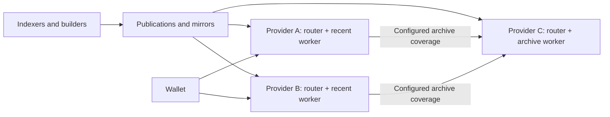

# Decentralized PIR query serving

This is a proposed architecture and phased implementation plan. It builds on
the existing services; it does not establish deployment, capacity or external
operator qualification. The [serving contract](serving-contract.md) and product
contracts continue to govern protocol behavior and trust.

## Goal

Let independent operators expose complete wallet-facing PIR endpoints without
running indexers or performing heavy publication construction. A few capable
organizations, potentially ValarGroup and Stardust, can run indexers and builders.
Many providers can serve recent data, where operator diversity and query
performance matter most. Fewer providers can maintain archive coverage.

The default external deployment embeds a router and worker in one serving
process. Operators can also run routers and workers separately when independent
scaling or hardware placement is useful. Both deployments use the same routing
and execution components.

A wallet can use a provider's endpoint directly. Initialization, manifests,
setup and queries must not require a shared query ingress operated by us.
Publication authority and distribution remain separate dependencies: distributing
query endpoints does not itself remove trust in indexers or guarantee publisher
availability.

## Responsibilities and boundaries

| Responsibility | Owns |
|---|---|
| Indexer and builder | Chain reads, record extraction, durable indexing, publication construction and heavy PIR preprocessing |
| Publication distributor | Authenticated revision discovery and immutable artifact delivery, directly or through mirrors |
| Local publication manager | Synchronization, verification, activation, retirement and serving eligibility for the operator's holdings |
| Router and worker | Wallet-facing API, coverage routing, query admission, encrypted evaluation and response packing |

Storage policy and execution topology are independent choices. Recent, archive
and combined holdings apply only where the product supports their semantics.
Enhance and Status packing routers perform computation, beyond forwarding HTTP;
their preparation, packing material and resource use belong in the provider's
requirements alongside evaluation.

Reuse these foundations:

- [External worker roles](operations.md#external-workers) provide product-owned
  configuration, installation and readiness reporting.
- [Transparent architecture](../transparent/docs/architecture.md) separates
  publishers and query workers and describes recent/archive assignments and
  prepared runtimes.
- [Enhance architecture](../enhance/docs/architecture.md) separates ingestion,
  ingress, packing and evaluation.
- [Status architecture](../enhance/docs/architecture_status.md) defines rolling
  observations and their freshness and authority rules.
- [Receiver](../receiver/README.md) has a staged-publication serving mode without
  indexing, with canonicality checks and explicit publisher-completeness trust.

These components do not yet establish autonomous provider operation. In
particular, existing controller-managed activation and optional local rebuilding
need explicit treatment before a node can promise lightweight operation.

## Implementation phases

### Phase 1: establish reusable service boundaries

Complete and reuse the service modularization already underway. Separate
ingestion, publication preparation, serving state and query execution. Keep
protocol definitions and cryptographic implementations in their existing owning
libraries, and keep release dependencies one-way from wallet-pir to
wallet-libraries.

Define routing and execution interfaces usable through local calls or remote
workers. The embedded path must preserve validation, authority, admission,
cancellation and response ownership. Keep product-specific limits, retention,
freshness, refusals and retries explicit.

**Deliverable:** independently buildable serving libraries with dependency checks
that exclude ingestion and other products' service implementations, including
development, build and target-specific dependencies.

**Exit criterion:** a serving installation has documented inputs and authority
requirements, and embedded and decoupled execution can compose the same components.

### Phase 2: publish independently consumable serving material

Turn publisher output into a documented distribution interface. Provide
authenticated revision discovery identifying coverage, required runtime/profile
versions, artifact identities and serving eligibility. Reuse existing product
manifests and runtime formats rather than creating a universal PIR format.

Distribute immutable, checksum-bound files. Support initial snapshots and
incremental synchronization by reusing unchanged artifacts. Include the material
needed for evaluation and response packing. A mirror may deliver identical bytes
without gaining authority to publish or declare them current.

Preserve product-specific reorg, revocation and freshness behavior. Publication
identity is separate from download location; downloaded material is separate from
authority to serve it. Products that currently require controller renewal retain
that requirement through an authenticated control path. A feed update alone must
not silently grant indefinite authority.

**Deliverable:** a publication source interface and verifier that operate without
our source checkout, private paths, indexer credentials or SSH deployment machinery.

**Exit criterion:** another organization can obtain and verify every artifact
needed for an exact publication, including compatible prepared runtime material.

### Phase 3: deliver the default embedded provider

Pilot with Transparent recent serving, which already has recent/archive
assignments and prepared-runtime mechanisms. Provide one operator-managed
installation with an embedded router and worker and a complete wallet-facing
endpoint. The operator configures the service, holdings, approved publisher,
resource budget and archive peers, and owns TLS and upgrades.

A local publication manager follows the configured holdings independently of
wallet requests. It downloads, stages and verifies candidates, then activates them
atomically. Interrupted downloads and restarts resume safely without making
partial publications available.

Lightweight mode requires compatible prepared material. Missing or incompatible
material produces a clear preparation refusal instead of silently starting an
expensive local build. Keep the last valid publication only while its existing
freshness, authority and revocation rules allow it.

Keep administrative interfaces private. Joining must not require our root access
or a fleet-wide credential. Avoid requiring a local archival chain node, while
preserving access to an appropriate canonicality source wherever the product
requires it.

**Deliverable:** an embedded provider installation with synchronization, bounded
resource use, restart recovery and separate process, verification, warmth,
authority and readiness reporting.

**Exit criterion:** an independent operator bootstraps, follows updates and serves
encrypted wallet queries directly within measured resource requirements, without
our administrative access or heavy local preprocessing.

### Phase 4: route across recent and archive providers

Use the embedded worker when it holds the exact requested publication and
qualifies to serve it. Route other coverage to explicitly configured providers
that support that publication and profile. Registration alone does not establish
loaded coverage, readiness, authority or encrypted-answer correctness.

Preserve encrypted framing, session binding, response validation and existing
retry restrictions, including uncertain evaluation acceptance. Bound forwarding
and prevent loops. Missing local data or unavailable archive coverage must never
become a successful empty result or an implicit public lookup.

Support separate routers and workers through the same interfaces. The operator
can move evaluation or packing to other hardware without changing the wallet API.
Optional shared ingress remains possible, but is unnecessary for direct operation.

**Deliverable:** coverage routing that supports local recent execution and remote
archive execution, with explicit refusal and peer-removal behavior.

**Exit criterion:** a wallet configured against one independent recent provider
can query its local recent holdings and configured archive coverage. Losing a peer
or receiving stale assignment information produces bounded failures under the
existing protocol.

### Phase 5: add publisher diversity and broaden service support

Introduce a second independent publisher after qualifying the first provider
workflow. Distinguish a mirror of identical bytes from an independently built
publication lineage. Keep manifests, runtime material and serving authority bound
to the selected lineage. Publisher switching is deliberate and validated; never
mix artifacts or sessions merely because their block ranges overlap.

Use the distribution machinery for archive holdings. Demonstrate that qualified
archive providers retain required coverage before recent providers retire local
copies. Extend the provider model to the remaining products using their existing
coverage semantics.

Publish reproducible installation instructions and measured requirements for
supported hardware variants. CPU qualification does not establish GPU readiness.

**Deliverable:** multiple independently operated publishers and serving endpoints,
with operator-owned configuration and documented coverage and resource requirements.

**Exit criterion:** demonstrate publisher outages and switching, mirror failure,
provider replacement and recent-to-archive continuity without changing wallet
protocols.

## Product coverage

| Product | Coverage constraint |
|---|---|
| Transparent history/display | Preserve each product's recent/archive boundaries and publication identities |
| Enhance | Recent holdings may cover a bounded set of query domains; older domains need qualified archive routes |
| Status | Preserve rolling observations, mempool coverage and freshness; archive mode is not an equivalent service |
| Receiver | Preserve complete history from Ironwood activation; truncating recovery history is outside this plan |

## Interfaces and validation

Add interfaces with their consumers in the owning phase:

- **Publication source:** authenticated revision discovery and immutable artifact
  retrieval.
- **Local publication manager:** synchronization, validation, activation,
  retirement and status.
- **Execution interface:** equivalent serving semantics for embedded evaluation
  and remote workers.
- **Coverage routing:** operator-controlled destinations qualified for exact
  publications.

Each phase requires focused tests and an independently reviewable result before
later phases depend on it. Preserve existing wallet-library clients and
independent correctness oracles. Exercise:

- Encrypted queries through the provider's complete HTTP endpoint, with equivalent
  answers and refusals in embedded and decoupled deployments.
- Corrupt, incomplete, incompatible and interrupted artifact downloads, and
  restart during synchronization, preparation and activation.
- Stale authority, revocation during preparation or evaluation, and chain reorgs.
- Client cancellation, slow transfers, overload and resource retention.
- Unavailable peers, outdated holdings, routing loops and safe retry boundaries.
- Publisher switching, mirror failure and rejection of mixed publication material.

Measure startup and update cost, steady-state memory, disk, synchronization
bandwidth and query performance together. Include packing costs, temporary
overlap between publications, verification and continued updates under query
load. Publish minimum requirements from measurements; retain existing product
freshness and qualification gates.

Artifact authentication establishes origin and integrity, not completeness of
indexed chain data. Preserve independent wallet validation and existing
completeness assumptions. PIR hides the selected record under the existing
protocol; providers and routers still observe the timing, traffic and coarse
routing information those protocols expose. This plan adds no new privacy claim.

## Defaults and exclusions

Start with explicitly approved publishers and configured peers. Direct provider
endpoints must work without automatic discovery or permissionless registration.
Keep wallet protocols, record layouts, session identities, validation and
persisted formats unchanged. Introduce no new consensus mechanism, incentive
system, PIR primitive or universal ingestion framework.

This plan does not authorize deployment or expand an existing refactor task.
Implement phases as focused changes; keep source completion, qualification and
production activation separate. Production activation requires its own explicit
authorization under the [fleet lifecycle](operations.md).
