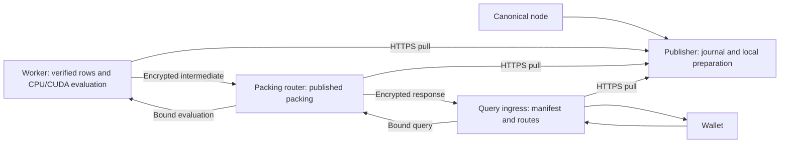

# Enhance publication and query serving

The publisher saves canonical records, prepares complete serving material once,
and publishes it over HTTPS. Workers, packing routers and query ingress follow
that source independently. The publisher has no consumer inventory and never
contacts a consumer to prepare, acknowledge or activate a publication.

The key invariant is that every encrypted request stays bound to the rows,
public setup, recovery identity and session it selected. A newer publication
never substitutes different material into an older admitted request.

## Ingestion application

The `pir-publisher` host runs canonical acquisition and local preparation through
supervised tasks. Acquisition commits complete blocks and coalesces preparation
into one active operation and one latest pending token. It continues while CPU
preparation runs on a blocking thread. A work token pins the committed journal
prefix and the withdrawal revision observed before preparation.

Generation reservation is durable before preparation starts. Publication verifies
all rows, hints, public setup and packing, syncs their immutable files, checks the
canonical anchor, then atomically advances current. A failed write poisons the
owner until reopen. A reorganization durably withdraws authority before journal
rewind; old work cannot publish after withdrawal, even if its rows are replayed.

## Data and query path

Caddy routes `/provider/enhance/v1/*` to the publisher artifact listener and
`/v1/enhance/*` to query ingress. Publisher operator routes remain private.
Worker evaluation, readiness, peer handover and metrics remain on private
listeners. Ingress configuration names both a router's control origin and query
origin. It checks readiness on the former and forwards to the latter with the
promised process incarnation.

## Placement, serving state and admission

Operator configuration owns domain responsibilities and downstream peers.
Workers download only assigned rows, verify hashes and lengths, and construct
the selected CPU or CUDA evaluation database without preparing hints. Routers
verify and map publisher-prepared packing, then require exact worker readiness.
Ingress advertises a publication only after every covered domain has compatible
router readiness. Future static responsibilities may be configured before those
domains exist; a publication with missing responsibilities remains unready.

Each process distinguishes candidate, active and retained material. Activation
atomically swaps local metadata and routes. Bounded consumer-to-consumer pins
keep material promised upstream alive during handover. Pins name the exact
manifest and process incarnation, expire after thirty seconds, and are capped
at sixty-four holders. An admitted task separately owns its material until its
response completes. Lost handover replies and peer restarts cannot pin forever
or silently move a request to a different incarnation.

Worker admission retains the existing full-growth and transition reservation:
at most five domains while any is active, or the selected six/seven sealed-domain
policy. Seven remains a hardware qualification choice. The resident model keeps
its existing overhead, growth and overlap limits. Router packing retains its
existing byte budget and complete-candidate overlap check. Cache/download
budgets are explicit disk/transport limits, separate from resident admission.

### Publication and serving authority

The query server's `synchronization` module serializes successful polls and
bounded error backoff over `pir-sync-manager` HTTPS transport. Product
adapters own schema, identity, recovery, loading, activation and refusal policy.
Waiting for a peer to load is deferred coordination; it does not start an
independent retry timer. Router and ingress maintenance renew peer promises
while loading or waiting.

Expected recovery waits proven by a well-formed publisher response (withdrawal,
absent or aged source authority, or authority that moved during a pass) refuse
serving like any failure, but poll every second for up to five minutes and then
every five seconds. Genuine failures, including publisher refusals, keep the
manager's exponential backoff. Requests renew authority on demand, so serving
resumes when a node or publisher edge returns without waiting for a pass. The
publisher publishes each committed prefix once; work reserved again for that
prefix while it prepared is skipped.

The publisher supplies authority only after a real canonical node observation.
Its five-second lifetime is never extended by an unchanged HTTP response or a
local timer. Processes persist publication/recovery floors before serving.
Cached bytes on restart confer no authority. Explicit withdrawal, revocation,
expired source authority and failed safety persistence close admission.

An ordinary update preserves still-authorized active and admitted views. A slow
request may renew authority for its exact original manifest before release.
Renewal must preserve its admission withdrawal revision: withdrawal followed by
fresh publication cannot revive that old request. Results and response bodies
remain guarded against live durable invalidations and expiry. A disconnected
source cannot supply a renewal.

## Composed domains and canonical routing

The fixed geometry, composition rules, canonical sessions, record layout and
wallet framing are unchanged; see [protocol](protocol.md) and the
[serving contract](../serving-contract.md). Reuse is determined by
exact unit/content/setup identities rather than equal whole-publication counters.
Unchanged material can serve a retained binding after ordinary advancement.
An incompatible profile, geometry, native format, identity or incarnation is
refused before evaluation against substitute material.

## Confirmation and recovery

A complete domain seals only after its completing block has one thousand
canonical confirmations. The publisher retains that completing height/hash and
detects unfenced changes. A rewind across sealed history raises recovery/domain
floors and revokes affected retained sessions before modifying journal bytes.
Ordinary append is not revocation. Source startup withdraws the last current
until it has fresh canonical validation.

## Record metadata and fees

The publisher derives each record's metadata from the canonical block, which it
reads through the server-only chain adapters (`zakura-server-chain`, `src/shared/pir-chain`):
they decode blocks and transactions, resolve spent outputs and compute fees, and the
publisher maps their results onto records. Every
Ironwood action of a transaction carries the same expiry, transparent input and
output flags, and fee. The fee is the whole transaction's: the remaining value of
its transaction value pool, that is transparent inputs minus transparent outputs
plus the Sprout, Sapling, Orchard and Ironwood value balances. It is not attributed
to an account or to individual actions.

A coinbase transaction has no fee of its own; its records have the fee-absent flag.
For any other transaction, every spent transparent output must be known. The
producer resolves spent outputs only for non-coinbase transactions with Ironwood
actions and transparent inputs: first from earlier transactions in the same block,
then from a bounded cache of recent outputs (`prevout_cache_outputs`, default
250,000 outputs, whole transactions evicted oldest first), then with one JSON-RPC 2.0
batch of `getrawtransaction` calls per 256 missing transactions. Returned
transactions must have the requested txid. A missing transaction (-5), an output
index past the transaction's outputs, a duplicate input, a negative value pool, or
any RPC or batch-shape error fails the whole block; the publisher retries it at
the next poll. The producer never publishes zero, a guess or a partial input total.
Blocks without such a transaction issue no extra RPC.

Cache entries are keyed by outpoint, and a txid commits to its outputs, so an entry
remains correct after a reorganization. Publishers before this rule published a
fee only for pure-Ironwood transactions. A restart with the fixed binary does not
change records already in the journal; [deployment](deployment.md#repairing-historical-fees)
describes the offline rebuild and its adoption.

## Wallet privacy and trust

PIR hides the row within the selected public domain under the existing q48 IPIR
assumptions. This lifecycle change does not introduce a new cryptographic primitive
or upgrade the underlying PIR security claim. Session hashes and response bindings
prevent accidental cross-context acceptance; they are not proof of canonical chain
membership or authentication of indexer metadata. Canonical anchor acceptance and
note authentication remain wallet responsibilities.

Domain selection remains public. Whole-database fan-out would scan every shard
for each query, reaching 24 times the single-shard work at the wallet ceiling.
The selected domain therefore exposes a coarse range of note positions.

During composition, compliant queries to B may target its occupied rows or A's
4,096-row suffix; queries to A canonically target the earlier rows. A still
physically holds its suffix, and PIR prevents the server from detecting a client
that queries those rows through A. Retained material can likewise describe old
coordinates. Routing freshness constrains accepted requests, but cannot make
those rows cryptographically unqueryable. The floor is a population policy for
clients following canonical routing, with the bootstrap and transition limits
above.

Default operation exposes selected domains, timing and query counts. Optional
birthday-based cover traffic queries every domain since the wallet birthday with
uniform round counts, fresh dummy queries and randomized order. A transient failure
retries a complete round; partial round results are not returned. Cover is off by
default and does not conceal timing, the birthday window, transport identity or
server availability. A persistent cover set and uniform behavior matter:
independently resampling decoys permits intersection across requests, while
retrying only the real query reveals its domain. Cover multiplies evaluation
work by the number of queried domains. See [wallet integration](integration.md).

## Package boundaries

`enhance-publisher` owns chain reading, ingestion, journals, local preparation,
publication and recovery. `pir-query-server` owns synchronization, all
Enhance serving roles and the private evaluation messages in its `enhance`
module; the root mounts the public routes. Neither has a publisher or
chain-reader dependency. Shared transport
lives in `pir-sync-manager` and scheduling in `pir-pipeline::consumer::polling`;
Enhance policy stays in Enhance.
The root hosts are `pir-publisher` and `pir-query-server`; product crates are
libraries. Test/workload composition belongs under `tools/`.

Within `enhance-publisher`, `chain_source` maps canonical blocks to records and
`journal` owns committed record storage. `publisher::EnhancePublisher` reserves
work and coordinates preparation; `publication` builds and verifies immutable
material, and `distribution::PublicationDistribution` publishes it through HTTP.
Each workflow keeps its lower-level mechanisms in private child modules.
Runtime recovery and offline handoff share the private durable-state types;
reading those types never grants serving authority.

## Validation and deployment

Small correctness fixtures retain real TLS, independent plaintext oracles,
negative identities, restart, storage failure and response-release checks.
Full-size, hardware, resource and sustained service qualification are separate
release gates. The [development plan](https-sync-development-plan.md) defines the
direct cutover and one-hour recovery requirement. Source and local tests do not
establish the state of production; use the locked [deployment](deployment.md)
transaction and its exact artifact/configuration evidence.
