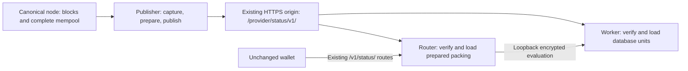

# Status prepared-publication distribution

This is the source interface for autonomous Status HTTPS consumers. It does not
claim a production cutover. Retained deployment records describe the binary and
configuration that were actually observed at their stated times.

## Ownership and data flow



The publisher retains the existing rolling source window, coverage rules, index,
salt, cryptographic profile and durable generation/recovery identity. It prepares
hints and packing material once on CPU, independently of consumer availability.
Workers load database coefficients into their selected CPU/CUDA backend; routers
map verified prepared packing material. Missing or incompatible material refuses
loading; neither role falls back to computing hints or packing matrices.

Worker and router stay separate processes on the existing host. Before announcing
a generation, the router selects the worker's reported inventory, verifies it
against the publisher and confirms that the worker can evaluate the exact wallet
manifest. Independent polling can temporarily produce an explicit unavailable or
conflict response; it cannot combine material from different generations.

## HTTPS contract

One explicitly configured TLS origin serves these routes:

- `GET /provider/status/v1/current`: schema, durable monotonic revision, recovery
  epoch, network, salt, latest generation, eligibility and inventory identity.
- `GET /provider/status/v1/objects/<sha256>`: immutable inventory JSON, fixed-shape
  database units, prepared packing blocks and wallet public parameters.
- `POST /provider/status/v1/anchors/check`: exact anchors of the candidate and
  active/retained views, bound to one current publisher snapshot.

Inventories bind the unchanged wallet manifest to object lengths and hashes.
Loaders also validate protocol, fixed geometry, prepared format, public-parameter
binding and database commitment. The publisher advances its public pointer only
after referenced objects and authority state are durable. TLS authenticates the
configured publisher; these hashes and attestations are not independent proofs
of canonicality or index completeness.

Consumers use the shared `pir-sync-manager` HTTPS transport, byte accounting and
sequential polling/backoff without a Status-specific scheduler. They persist
publisher high-water marks and observed invalidations before allowing service.
Withdrawal or a new recovery epoch fences active service. Exact-anchor checks
also catch invalidated older views after a consumer skips an intermediate update.
A disk failure persisting authority closes admission. Restart reuses completed
immutable objects, but requires fresh HTTPS authority before serving.

Each state directory has one exclusive owner. Downloads use temporary files,
verify their full length/digest, fsync, then publish read-only immutable inodes.
Collection only unlinks objects; mappings and admitted requests pin their inodes
or immutable memory. Publisher retention includes still-fresh predecessors and
current material; consumer retention covers current and predecessor inventories.
Authority/revocation records are never garbage-collected with artifact files.

## Timing and wallet compatibility

The shared loop currently waits about five seconds after successful passes and
backs off after failures. The old five-second publisher-contact watchdog and
push preparation/activation routes are removed. Retry timing is scheduling,
never permission to answer queries.

The wallet protocol and its twenty-second observation-age limit are unchanged.
That value remains the current product policy, not a cryptographic parameter.
Only a successful source observation can supply a fresh `observed_ms`, including
when unchanged contents reuse prepared objects. A `304`, successful download,
canonicality attestation, heartbeat or retry cannot renew an old observation.
Admission and response completion still reject stale or revoked generations.

Healthy-source availability within that bound must be measured with actual
preparation, transfer and query load. Failure backoff may outlast it; Status then
refuses answers until a new verified observation is available. Changing the
wallet-visible bound requires a separate coordinated client change.

## Configuration

The publisher's existing Status section keeps source RPC/cookie settings and
`publisher.state_dir`, `salt_hex`, `window_blocks`, `private_listen`. Remove
`publisher.worker_origin` and `publisher.router_origin`.

Worker/router settings require `publisher` (HTTPS origin), `network_hex`, private
listeners and a separate absolute `state_dir`. `publisher_ca` optionally names an
installed additional trust root. The router's `worker_origin` remains a loopback
HTTP evaluation address. The typed examples live beside `tools/status/deploy/`.
Old push-mode settings are rejected rather than selecting a compatibility mode.

## Production preparation and rollback

`tools/scripts/wallet-pir-deploy.py status-https-{plan,preflight,deploy,status,rollback}`
is the supported direct-cutover path. This PR prepares that path; using `deploy`
requires a separate production decision and qualified release artifacts.

A private `status-https-cutover/1` request pins the full source revision, existing
public HTTPS origin, machine identities, the publisher/worker/router installed
configuration hashes, staged binary paths/digests and desired configurations.
Every binary must already be in its immutable digest-named release directory.
The request also binds the fleet's independent encrypted-answer probes for
Enhance, Status, Transparent history and transaction details.

`plan` is read-only. `preflight` checks the current identities and files, validates
candidate configurations in temporary copies, validates the TLS edge and runs
baseline probes. It does not open a second writer against live source state.
Measured publisher CPU/memory and active/candidate storage requirements remain
release gates; the free-space floor alone is not proof of capacity.

The reviewed `plan_sha256` is required by `deploy`. Under the existing production
lock it journals the previous configuration, executable identities and every
intent; preserves credential launchers, other products and wallet routes; installs
only the Status configurations, service overrides, fleet variables and new TLS
distribution handler; then starts the publisher and both consumers. New consumer
state directories are separate from the predecessor directories.

The twenty-minute recovery window starts at the first service-affecting change.
The runner verifies executable identities, fresh readiness and all four independent
answer probes. Failure or expiration starts rollback. Run this operation in the
persistent operator job infrastructure: a durable journal permits recovery after
runner failure, but does not itself execute rollback if the runner disappears.

With the same request and its exact checksum, recover using:

```sh
python3 tools/scripts/wallet-pir-deploy.py --inventory "$INV" --state-dir "$STATE" \
  status-https-status --request "$REQUEST" --request-sha256 "$REQUEST_SHA"
python3 tools/scripts/wallet-pir-deploy.py --inventory "$INV" --state-dir "$STATE" \
  status-https-rollback --request "$REQUEST" --request-sha256 "$REQUEST_SHA"
```

Rollback refuses foreign managed-file or unit changes and changed rollback
executables. It restores the captured configuration and verifies the predecessor
services and independent answers. New synchronization directories and safety
records remain intact; no journal, source history or revocation record is erased.

The external-worker installation rehearsal proves process identity and restart
only when no real HTTPS publication is configured. It reports encrypted answers
as unexecuted. Real TLS lifecycle checks, unchanged-wallet compatibility, CUDA
qualification where used and the [six-hour live-source gate](status_qualification.md)
remain distinct evidence requirements.
