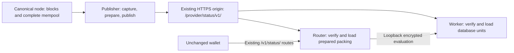

# Status prepared-publication distribution

Status uses autonomous HTTPS publication. This page describes the source
interface and operating model; retained deployment records describe the binary
and configuration observed at their stated times.

## Ownership and data flow

The publisher retains the existing rolling source window, coverage rules, index,
salt, cryptographic profile and durable generation/recovery identity. It prepares
hints and packing material once on CPU, independently of consumer availability.
Workers load database coefficients into the CPU backend; routers
map verified prepared packing material. Missing or incompatible material refuses
loading; neither role falls back to computing hints or packing matrices.

Worker and router stay separate processes on the existing host. Before announcing
a generation, the router selects the worker's reported inventory, verifies it
against the publisher and confirms that the worker can evaluate the exact wallet
manifest. A private pin/commit handover holds the router's previous and incoming
views while it persists and switches them. Worker updates defer through the
existing retention backpressure until that handover completes; expired views
remain unusable and their holds are released. A lost acknowledgment is retried on
the normal shared polling schedule. No publisher heartbeat or new lease is added.
Independent polling cannot combine material from different generations.

## HTTPS contract

One explicitly configured TLS origin serves these routes:

- `GET /provider/status/v1/current`: schema, durable monotonic revision, recovery
  epoch, network, salt, latest generation, eligibility and inventory identity.
- `GET /provider/status/v1/objects/<sha256>`: immutable inventory JSON, fixed-shape
  database units, prepared packing blocks and wallet public parameters.
- `POST /provider/status/v1/authority/check`: exact anchors of the candidate and
  active/retained views, bound to one current publisher pointer.

These paths, the pointer succession rule, the conditional-request tag and the
authority-check request/response shape are the shared `pir-publication`
contract; Status supplies the pointer fields, inventory and anchor subject. The
publisher serves only objects of retained publications and refuses any other
name before opening a file.

Inventories bind the unchanged wallet manifest to object lengths and hashes.
Loaders also validate protocol, fixed geometry, prepared format, public-parameter
binding and database commitment. The publisher advances its public pointer only
after referenced objects and authority state are durable. TLS authenticates the
configured publisher; these hashes and attestations are not independent proofs
of canonicality or index completeness.

Consumers run the query server's shared publication lifecycle
(`pir_query_server::synchronization::publication_lifecycle`) (observe,
fence, plan, fetch, load, revalidate, commit, retain) with `pir-sync-manager` HTTPS transport, byte
accounting and sequential polling/backoff; Status hooks only choose, load and
install material. They persist the publisher floor (newest pointer, publisher
origin, product namespace, chain and observed invalidations) before allowing
service; a floor bound to another source is refused, and a floor written before
source binding keeps its replay protection.
Withdrawal or a new recovery epoch fences active service. Exact-anchor checks
also catch invalidated older views after a consumer skips an intermediate update.
A negative anchor answer revokes only the views bound to that anchor. Other
fresh sessions keep working, including a retained session when the latest view
was invalidated. The shared engine owns revocation and its floor write together,
so cancelling a synchronization pass cannot lose or repeat the invalidation.
Revoked material still pinned by an in-flight request remains retained until
the request releases it and a later activation retires that view.
A revoked view cannot prevent loading a verified replacement. Withdrawal during
candidate preparation reopens publisher authority before the next publication.
A disk failure persisting authority closes admission. Restart reuses completed
immutable objects, but requires fresh HTTPS authority before serving.

Publisher service discovery is checked before startup opens product state or
binds listeners, and before each synchronization pass. An incompatible contract
major version stops the query-server host; ordinary failures during polling use
the shared retry schedule. Discovery never grants serving authority. Status
retains its own freshness and worker/router handover checks as lifecycle hooks.
The shared object cache enforces exact lengths and hashes and owns durable file
promotion; loading verifies objects again before activation.

Each state directory has one exclusive owner. Downloads use temporary files,
verify their full length/digest, fsync, then publish read-only immutable inodes.
Collection only unlinks objects; mappings and admitted requests pin their inodes
or immutable memory. Publisher retention includes still-fresh predecessors and
current material; consumer retention covers current and predecessor inventories.
Authority/revocation records are never garbage-collected with artifact files.

## Timing and wallet compatibility

Status configures the shared loop to wait one second after successful passes
and back off after failures. The old five-second publisher-contact watchdog and
push preparation/activation routes are removed. Retry timing is scheduling,
never permission to answer queries.

The wallet protocol and its twenty-second observation-age limit are unchanged.
That value remains the current product policy, not a cryptographic parameter.
Only a successful source observation can supply a fresh `observed_ms`, including
when unchanged contents reuse prepared objects. A `304`, successful download,
canonicality attestation, heartbeat or retry cannot renew an old observation.
Admission and response completion still reject stale or revoked generations.

Healthy-source availability within that bound must be measured with actual
preparation, transfer and query load. Failure backoff may outlast it; Status then
refuses answers until a new verified observation is available. Changing the
wallet-visible bound requires a separate coordinated client change.

## Configuration

The publisher's existing Status section keeps source RPC/cookie settings and
`publisher.state_dir`, `salt_hex`, `window_blocks`, `private_listen`. Remove
`publisher.worker_origin` and `publisher.router_origin`.

Worker/router settings require `publisher` (HTTPS origin), `network_hex`, private
listeners and a separate absolute `state_dir`. `publisher_ca` optionally names an
installed additional trust root. The router's `worker_origin` remains a loopback
HTTP evaluation address. The typed examples live beside `tools/status/deploy/`.
Old push-mode settings are rejected rather than selecting a compatibility mode.

## Operations and qualification

Use the [fleet operator guide](../operations.md) for normal deployment, status
and rollback procedures. The one-time push-to-HTTPS cutover commands are retired;
new deployments use the HTTPS role configurations directly. Retained transaction
records and predecessor state are historical evidence, not configuration inputs.

The shared publication format requires a coordinated publisher and query-server
cutover. On first open, the publisher rewrites its earlier generation-counter
file in place, preserving the last committed generation and manifest. This
rewrite is locked and synced before publication; it does not restore serving
permission. The shared authority starts withdrawn in its new file, and query
servers use the new publication-floor file. Keep the matching older binaries
and state together for rollback.

Publication no longer needs an SSH artifact reverse forward. The shared session
supervisor still carries private worker/router monitoring and the wallet query
connection. The publisher's private listener remains the upstream for the HTTPS
edge; the router's worker connection remains private encrypted evaluation.

The external-worker installation rehearsal proves process identity and restart
only when no real HTTPS publication is configured. It reports encrypted answers
as unexecuted. Real TLS lifecycle checks, unchanged-wallet compatibility and the [six-hour live-source gate](status_qualification.md)
remain distinct evidence requirements.
