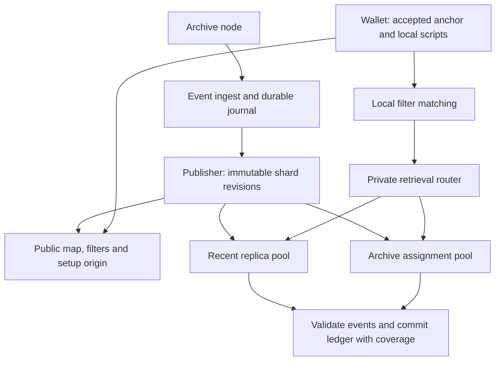

# Transparent PIR architecture

This describes the system as it exists in this repository's source. [Status](status.md)
records what is published and live, [deployment](deployment.md) owns the accepted
operating targets, and the [contract](contract.md) defines the completeness, privacy
and failure requirements all of it serves. Source establishes implementation and never establishes a deployment. The source
history schema is `transparent-shard-v12`; the [October 13 retirement
record](../evidence/v1-sunset-2026-10-13/README.md) records v2 history/display serving
and the journal handover. The older v10 [cutover](../evidence/v10-cutover-2026-09-28/README.md)
and [compact-layout analysis](../evidence/compact-layout-2026-09-28/README.md) are
historical inputs. Shared operating procedures are in the [fleet guide](../../docs/operations.md).

## Data and recovery

The service indexes confirmed receive and spend events under exact raw locking scripts.
Spend extraction resolves each consumed previous output to its script. The wallet
reconstructs a ledger, applies its own confirmation and spendability policy, and accepts
its chain anchor independently of shielded scanning.

A private table indexes scripts of at most 40 bytes, which covers the profile's supported
classes. The public filter still carries every element a block yields, so a longer script
can match a filter and be absent from the directory. Each manifest publishes both the
limit and the number of scripts it excluded, so a wallet holding one is told it is outside
coverage instead of reading a directory miss as absence.

A shard is a consecutive height range (called a generation in historical research). Each
shard has a public activity filter, a private two-choice script directory and private
packed event pages. Short histories may fit inline. A table can have multiple
equal-geometry segments for an indivisible oversized block. Both directory candidate rows
and every required page are retrieved privately across all table segments; routing must
not expose the chosen row or segment.

The assignment pools and the router are implemented: `shard-assign` plans a
`transparent-assignment-v1` from a roster, a worker loads either a whole published set or
only its assignment's shards, and the router's configuration is rendered from the
assignment alone and routes on the shard id in the path. The separate artifact origin is a
target; the publisher's own origins serve the public map, filters and setup today.

## Private transparent display capability

[Txid display](txid-display.md) answers one question privately: what a wallet
should show for one transparent transaction. Each transaction with a
transparent input or output has one fixed 113-byte entry (`transparent-txid-display-v2`):
- the fee, input and output counts, and a shielded-components bit;
- the first address-shaped source;
- outputs 0 and 1;
- flags naming what the entry leaves out (more source scripts, more outputs,
  shielded plus transparent funding).

Senders come from the spent outputs the extractor already resolves for fees.
This is separate from script history discovery.

The extractor writes the entries into block-hash-addressed sidecars under the
existing event checkpoint. The tiered `txid-display-controller` publishes them
as sealed archive shards of 180,000 entries and one per-block recent shard, a
window of the newest 180,000 entries that may overlap the newest archives.
Inside a shard, each hash bucket is one `txid-4k8` table (4,096 rows) of 72-entry,
8,192-byte rows, and an entry has one row under the bucket's published
placement seed. A lookup is always one row query, so the server learns the
range, tier, bucket and timing, but never the size of the transaction.

`transparent-txid-server` serves the tables in archive-owner, recent-replica
and combined roles. It shares the native runtime, cache and admission code
with history serving, but not `ShardSet`. History manifests and serving carry
no display tables.

A display failure cannot authorize a public lookup; a wallet asks publicly
only when the user explicitly requests it for one transaction. It is source
and local evidence only.

## Component ownership

| Component | Source | Responsibility |
|---|---|---|
| Events | `transparent/crates/transparent-events` | Canonical 87-byte chain event record |
| Filters | `transparent/crates/transparent-filter` | Range filter profiles, keying, encoding and validation |
| Shard protocol | `transparent/crates/transparent-shard` | Geometry registry, script tags, placement, deterministic packing, choice tables, manifests and sealing |
| Native PIR profile | `transparent/crates/transparent-native` over `shared/pir-native` | Transparent's seeds and scheme identity over the two-mask ReinspiRING helpers all three products share |
| Ingest, census, publish | `transparent/services/transparent-filter-server` | Resolve events, persist journal, seal and build shards, serve filters |
| Retrieval service | `transparent/services/transparent-shard-server` | Verify publication, bound runtime cache, revision-addressed setup/query |
| Wallet | `transparent/crates/transparent-wallet` | Local matching, private retrieval, validation, ledger replay |
| Wallet store | `transparent/crates/transparent-wallet-store` | Reference durable store on SQLite |
| Comparison baseline | `transparent/crates/transparent-blocks`, `transparent/services/transparent-block-server` | Pinned compact-block datasets for benchmark comparison; not a lightwalletd implementation |
| Deployment | `ops/` and `.github/workflows/` | Build, distribute, preflight and activate artifacts |

## Public membership filters

Each shard publishes one Golomb-coded set over the scripts active in its range, keyed by
profile name, genesis hash, shard id, height range and terminal block hash. Two range
profiles are compiled: `zcash-transparent-range-v1` at `P = 19, M = 784,931`, BIP 158's
basic parameters, and `zcash-transparent-range-v2` at `P = 10, M = 1,024`, about 45%
smaller and tuned for wallets testing up to roughly a hundred scripts. The publisher, the
shard builder and the wallet all take `P` and `M` from the published name and refuse a
name they do not know; read under another profile's parameters a filter neither fails
reliably nor matches correctly. Changing a set's profile is a new publication rather than
a continuation of one.

A false match costs one directory lookup, resolved by the tag comparison against the
retrieved row, and never creates a ledger event. Precision is therefore charged against
the number of scripts a wallet tests, not against block downloads as in BIP 158.

## Identity and geometry

The source schema is `transparent-shard-v12` ([design](decoupled-pages-design.md)). Both
tables retain 4,096-byte rows, which is one native PIR instance. Entries and events have
variable widths within those rows. Earlier shard bytes are refused, not reinterpreted.

A shard is a *directory shard*: one directory table over its range and up to 32 *page
shards*, each its own table over a consecutive part of the range, served as the table
`pages-<j>` of the directory shard's revision. The manifest lists them as `page_children`:
range, terminal block, tag-salt counter, sealed flag, segment digests and occupancy. The
directory shard is the only lineage: revisions, staleness, 409s and worker assignment are per
directory shard, and the map's `page_segments` counts its page shards. A page shard's
identity chains through every earlier one and the directory shard's position, so a sealed
page shard keeps its identity, its runtime and a wallet's cached runs across revisions.

A shard declares a named geometry from the compiled registry: `decoupled-2k-8k` (2,048
directory rows, page shards of 8,192 rows) for the recent tier and `decoupled-32k-32k`
(32,768 and 32,768) for the archive. The registry varies row counts only. Row width
and the inline allowance are compiled into the record codec, so moving either is a schema
bump and a republication rather than a new registry entry, and the build refuses to
publish a shape it can score but not encode.

A manifest commits layout and table digests; the public map names manifest revisions.
Sealed contents remain immutable and manifests chain through parent digests. A tier
boundary must be a shard boundary. Profile names must never be reused with different row
shapes.

Revision identity must be preserved through setup, query, response, runtime cache and
wallet coverage. The server verifies manifests when opening a set. The wallet retrieves and
verifies revision manifests, their map fields, parent digests and registry geometry before
private requests. Hash consistency does not prove completeness or authenticate a malicious
publisher's index merely because its terminal block hash is accepted.

The publisher supports recent/archive geometry and a forced `--recent-from` height. Census
supports bounded inclusive ranges. A combined mixed-tier cost report must use the same
boundaries and aggregate exact scripts across tiers; separate tier percentile summaries
cannot be added.

The event journal is version 2 and stores the 87-byte record. Opening a version-1 journal
returns an error and leaves the files in place; a version-2 journal is built only into a
new directory, either by re-ingest or by `journal-convert-v1`, which reads a committed
prefix of the source without taking a writer lock and renames the result into place only
once it is durable.

## Private record layout

Every PIR row is exactly 4,096 bytes. Entry offsets inside it depend on preceding
entry lengths, so decoding scans from the row header. Unknown flags, counts above
the row's decoder bounds, malformed references and nonzero trailing padding are
refused. Fixed response width remains unchanged; the number of page queries now
depends on event kinds and local receive/spend adjacency as well as history length.
That additional dependence was accepted for this layout.

A directory row starts with a 4-byte occupied-entry count, then packed entries.
Each entry contains a 14-byte script tag, a `flags_child` byte, a 4-byte `head_row`
and the newest one or two compact events. `flags_child` bits 0-4 name the page shard
holding the script's newest run, bit 7 marks exactly one inline event, and bits 5-6
are zero. `head_row` is the 1-based row of that run's first fragment; zero means the
script has no pages in the directory shard, and then the page bits are zero. A paged
entry must carry two inline events, and the page shard it names must be one the
manifest declares. There is no stored total or fragment count. Entry sizes range
from 70 to 177 bytes; a linked receive/spend pair takes 113 bytes including its
header. At most 58 minimum-size entries fit a row. Unused inline slots and their
sentinel are gone; only the row's unused suffix is zero padding.

Compact events use these three canonical encodings, without alignment:

| Kind | Fields after flags | Bytes |
|---|---|---:|
| Receive | transaction index u16, height u32, value u64, txid 32, output index u32 | 51 |
| Spend | transaction index u16, height u32, spending txid 32, input index u32, spent txid 32, spent output index u32 | 79 |
| Local spend | transaction index u16, height u32, spending txid 32, input index u32 | 43 |

All integers are little endian. Flag bit 0 identifies a spend, bit 1 is coinbase
on receives only, and bit 2 marks a local spend. A local spend reconstructs its
outpoint from the immediately preceding receive in the same entry, and is
mandatory when that receive matches. References reset at every directory entry
and page fragment. An ordinary full outpoint in that situation is noncanonical.
The all-zero receive remains invalid. No form stores a script or block hash;
the wallet resolves height against its accepted chain.

A script keeps its two newest events in the directory shard inline. When a third
arrives, the oldest inline event is pushed out into the script's *run* in the page
shard open at that block, never the one where the event happened, which may have
sealed. A script has at most one run per page shard, runs are in time order, and the
entry names only the newest. A run's fragments occupy consecutive rows from its first;
the first reports fragment count `K` and links back to the previous run:
`prev_child`, `prev_row` (1-based, zero ends the chain) and `older_runs`, the number
of runs older than it. Pointers only go backwards, to page shards that sealed before
the run started receiving events, so a run and its link are fixed when its page shard
seals.

The wallet makes one directory query, then one round trip per run: the rest of the
current run together with the previous run's first row. It checks ordinals `0..K-1`,
one shared `K`, canonical event order and greedy fragment boundaries within a run;
across the chain it checks that page shard numbers strictly decrease, that
`older_runs` drops by one per hop and is zero exactly where the chain ends, that
events strictly increase into the inline events, and that every paged event's
second successor lies in the range of the page shard it was pushed into. Runs in
sealed page shards are cached by page-shard identity and script, each with its own
events and a link to the script's previous cached run, so a tip catch-up stops at
the first cached run and rebuilds the older history from the cache. Covering a
script over a whole sealed directory shard drops its cached runs there. Pending work holds a run cursor, checked fragments saved after each response,
and the events the placement check carries; events and coverage commit only when
the run is complete. Query and byte budgets stop page retrieval between atomic
responses, including setup downloads. Finite byte budgets dispatch sequentially;
with no byte ceiling, concurrent rounds are capped by the remaining query count.
SQLite schema 7 holds the cursor, saved fragments, the run cache and per-entry
content-failure counts. Opening a schema-6 cache adds the empty failure-count
table and updates the version in one transaction, preserving its history,
coverage, saved walks, caches and any wallet-libraries catalog in the same file.
Other schema versions are refused.

Row content in a private reply that does not decode or check out, including a run
link the shard cannot follow, or a record that contradicts the store, fails one
directory entry (one script in one shard), not the sync. Each script's planned directory queries are all sent before
any is decoded, and the shard's directory commit still lands for its other scripts;
a failed entry sends no pages. A failed page walk keeps its pending item while the
other walks finish, and still sends, as dummy queries to its current run's page
shard, the fragments a validated head had committed it to and one query in place of
any bad link (an undeclared or later page shard, a broken older-run count, a row
outside the table). It sends no link query when the chain promised no older run, or
when the previous run is already cached, because the honest walk sends none either.
The previous run is the one in the page shard the link names when that page shard is
declared and earlier, and otherwise the one in the page shard just below. Nothing that depends on the bad reply is sent. A reply whose
length, revision binding or parameter epoch does not verify was made without
knowledge of the row, so it fails the request as before; an epoch mismatch also
drops the cached setup. The store counts content
failures per (shard, script) and never resets them; an entry at three is not
queried again, and the sync reports `content-failed` with the failed entries. A
malformed map or manifest, a broken filter or a lost answer in a round still stops
the sync, as do request failures (refusals, overload, stale revisions), which do
not count.

A page row starts with a 4-byte entry count. Each entry has a 40-byte header:
script tag, fragment ordinal, fragment count, event count, two height bounds and the
run link, all zero on later fragments. The event payload has a 4,052-byte budget.
Greedy fragmentation takes the longest prefix that fits it: up to 79 receives, 51
ordinary spends or 86 events arranged as 43 local receive/spend pairs. The manifest's
`events_per_page = 86` is a decoder bound, not a fixed fragment length. At most 44
minimum-size page entries fit a row.

Long histories take contiguous runs in raw-script order. Their final rows offer
spare space to single-fragment histories. Short entries are ordered by decreasing
encoded byte length, then raw script, and placed in the tightest available row,
with row index breaking ties. An equal-byte-size grouping is also counted; the
builder uses it if it needs fewer rows and otherwise uses mixed packing. Neither
strategy claims optimal bin packing. The builder and sealer share the exact
byte-demand calculation, and publication verifies that the emitted row count
matches it. Sharing a row does not let a wallet skip another script's private
query.

### Sealing and capacity

The sealer projects each whole block into the open directory shard and its open page
shard. A page shard that would overflow closes and the block is projected into the
next; a directory shard that would overflow in either projection closes with its page
shard. After the block, a directory shard at its script or byte target closes with its
page shard, and otherwise a page shard at its page-row target closes alone, taking its
directory shard with it when it was the 32nd. Directory bytes have a capacity of
`directory_rows * 4092` and a target reserving one seventh, independently of the
absolute script-count bound. The page target reserves one thirty-second. Tier
boundaries close both. The publisher resumes the sealer at the open directory shard's
start, so a fresh build equals block-by-block publication, and links sealed page
shards the previous revision already published. The
byte reserve helps placement but does not prove that every shard fits one
segment. An indivisible oversized block still receives extra segments.

Compact storage changes shard boundaries and public filters, so adoption requires
a separate publication and corresponding clients. Per-row native PIR geometry
is unchanged, but denser bytes can change native noise bounds and table workloads.
Capacity measurements do not establish throughput, latency or native correctness
for a new served snapshot; those require qualification on its actual tables.

### Script tags

A record identifies its script by a 14-byte tag rather than the raw bytes: the first 14
bytes of a domain-separated SHA-256 over the complete script under a per-revision salt. The
salt is itself a domain-separated SHA-256 of the shard id, the revision's terminal block
hash in internal byte order and a `tag_salt_counter` field the manifest carries. The wallet
recomputes the salt from those three verified inputs and never accepts one supplied
separately, so a publisher cannot choose a predictable salt, and every transaction in a
revision is mined at or before its terminal block, so no indexed script can have been
selected against a known salt.

Page shards salt their tags separately, over the directory shard's id, the page shard's
index, end height and terminal block and its own counter, so a sealed page shard's tags
do not move while the directory shard around it grows.

The counter starts at 0 and increases only when the builder finds two indexed scripts whose
tags collide, at which point it recomputes every tag and checks again, up to eight times. It
never drops a script and never publishes duplicate tags. Placement and the choice table stay
keyed on the raw script, so moving the counter changes tags alone.

This replaces byte-for-byte script equality with attribution under a 112-bit tag. The wallet
compares tags only within the candidate rows it retrieved and reaches a page only through a
directory match, so the exposure is a wrong event attributed to a wallet whose script
collides with an indexed one, not a privacy leak, and rows carry no integrity authentication
in any case: a server that lies can return wrong events at any tag length. Duplicate tags in
a decoded row, a tag that disagrees between directory and page, and any count, order or
padding failure stop recovery for the shard. None of them may fall back to prefix matching
or to public address retrieval.

## Directory placement and the choice table

Each script has two candidate directory rows, hashed under independently domain-separated
per-shard salts, so a row learned in one shard says nothing about the same script's row in
another. Placement processes decreasing entry sizes, then raw script, choosing
the less occupied candidate by bytes. If neither fits, a bounded deterministic
relocation search tries moving residents to their alternate candidates. Its
512-node limit and single-resident moves can miss a feasible packing; failure
adds a directory segment and retries. A failure never triggers public lookup.

Without a choice table the wallet retrieves both candidates, because querying one and
stopping on a hit would make the query count a function of where the script landed. A
manifest may instead publish a choice table: an xor-retrieval function over three equal bit
segments, three positions per key whose xor is that key's bit, at about 1.23 bits per placed
script. It stores no key, fingerprint or row, and it is not a membership test — a script
that was never placed evaluates to an arbitrary bit, and the tag comparison against the
returned row is what settles absence, exactly as it does for the two-query lookup.
Construction is deterministic in the shard id and the placed pairs, retrying seeds until one
peels.

The table is optional: a manifest without it serializes without the field and keeps its
bytes and digest. A manifest that carries one is not backward compatible, because consumers
built before the field drop it, recompute a different manifest digest and refuse the shard.
The publisher adds tables only to revisions it builds anew (`--directory-choice
off|sealed|all`, default `off`) and verifies that the table routes every script to its row
while it still has the scripts. A private row stores a tag rather than the raw script, so the
route cannot be recomputed at load; the server decodes every directory row and checks that
the table's key count equals the entry count.

## PIR scheme

Both history tables and the txid display table use the native ReinspiRING two-mask **8-bit** profile from ipir-sp
`v0.1.0-rc.7`: d = 2,048, q = 2^54, p = 2^8, a one-digit Gaussian `K_g` packing key with a
27-bit digit, two public masks rounded to 22 bits, 28-bit dithered queries and 10-bit
responses (profile `reinspiring-two-mask-p8-g27x1-m22-dq28-r10-v1`). Each coefficient
carries one plaintext byte, so one 4,096-byte row is two 2,048-coefficient blocks and a
display row of 8,192 bytes four. The 16-bit m29 profile that Enhance and Status deploy
(p = 2^16, a two-digit key with 19-bit digits, 29-bit masks, 44-bit dithered or 49-bit
nearest queries, 22-bit responses) serves no table built from `main`; `/v1/` releases
still serve it.
The helpers are the root `shared/pir-native` crate, which Enhance and Status use too; it
defines both profiles (`P8`, `P16`) and its golden test pins the 16-bit bytes. It has no
Cargo features, so depending on it cannot switch the q48 Enhance binaries, which only
`enhance-pir/native-reinspiring` does. `transparent/crates/transparent-native` re-exports
it and adds Transparent's per-geometry seeds, `NativeScheme`, `TableProfile` and
`profile_for`, which picks the profile from the table name.

Query masks and the packing setup are derived from 32-byte seeds per schema, geometry and
table (labelled per profile), so one query is answered by every segment of every shard of
that geometry. `/v2/shards/init` publishes each table's `NativeScheme` identity (bit
widths, parameter encoding, mask seed, setup id and sizes); the wallet re-derives it and
refuses any difference. Each history segment publishes its own 22,528 bytes of rounded
masks (11,264 per block). A query is an 8-byte revision binding, the 13,824-byte key and a
28-bit dithered selection (`rows * 28 / 8` bytes): 21,000 bytes at 2,048 rows, 42,504 at
8,192 and 128,520 at 32,768. The client rounds each coefficient up with probability equal
to the fraction it drops, using fresh coins, so the rounding errors are independent and
zero mean. Init publishes this one scheme as `directory_scheme` and `pages_scheme` and
omits `*_scheme_dq44`; the server accepts exactly the 28-bit lengths and refuses any other
before reading the body. Each segment answers with the binding, an 8-byte mask epoch and a
5,120-byte body (two blocks of 2,560).

The server keeps an 8-bit table's bytes in the byte kernel's interleaved layout
(`reinspiring::native_kernel::PreparedU16Query::interleave_u8_columns`, 16-column bands of
four-row groups) and scans them with `multiply_interleaved_u8`; the portable path scans the
same layout, so a cache entry restores on any CPU. The hint is computed over the
column-major bytes before interleaving, leaving out trailing all-zero row blocks as the
16-bit runtime does. The compiled one-digit matrix needs eight-byte words on a table with
data, so its runtime plans at its reservation; only a nearly empty table's matrix is written
at four-byte words, and the disk cache accepts either.

A display table (`txid-4k8`, 4,096 rows) takes a 28,168-byte query (21,000 at
`txid-2k8`'s 2,048 rows) and publishes
one scheme, `scheme`, with no `scheme_dq44`. Each display segment publishes 45,056 bytes of
masks (four blocks) and answers with the binding, the epoch and a 10,240-byte body. Its
seeds are derived under display's own native schema, `transparent-txid-display-p8-v1`,
which `/v2/txid/init` publishes as `native_schema`; a client pinned to the 16-bit display's
`transparent-shard-v11` finds the service unsupported.

A query to a single-segment page shard, sealed or open, may select only its first
`PageChild::query_rows`: the page rows it holds rounded up to 2,048-row blocks, every
later row being zero, so the answer is unchanged. While a page shard holds at most
2,048 rows that is 21,000 bytes. The count comes from digest-bound manifest fields alone,
so every query to that page shard has one length. Multi-segment page shards and the
directory select every row, and servers also accept the full selection: two exact lengths
for a page shard, one for the directory. Segment verification, at startup, on cache restore
and before a runtime build, refuses a page shard whose rows past that count hold data.

Correctness certificates for this mode are snapshot-specific. The shard server's
`native_certificate` example exports the `certify_native.py` report for a segment; for an
8-bit table it is always the dithered 28-bit report. The
[8-bit trial](../evidence/p8-trial-2026-10-12/README.md) certified every v12 staging table
at 125 bits or more with the one-digit key, under trial seeds; the served seeds need their
own certificates. `native_certificate` derives display tables under display's native
schema. The 16-bit display tables' screens are the
[correctness screen](../evidence/native-certificate-2026-09-28/README.md) and the
[dithered query screen](../evidence/dithered-query-2026-10-09/README.md).

## The wallet's walk

The wallet walks shards in order and commits each one atomically, but it need not wait for
one shard's requests before sending the next shard's. The reference HTTP filter source
fetches a walk's uncached filters concurrently. When the shard transport reports a
concurrency above one and the sync has no work budget, the wallet matches every uncached
shard of a pass locally first, then sends that pass's manifests and missing directory setups
as one batch and, once the manifests verify, its directory queries as another. The walk
consumes each outcome where it would have made that request, so the requests per shard and
table, the byte charges, commits, refusal handling and retry budgets are those of the
sequential walk; only their timing changes. Page setups and page queries stay sequential,
because which pages a script needs is known only after its directory entry decodes.
Concurrency 1 is the sequential walk. Requests sent ahead for shards the walk does not
reach, because it stopped or refreshed the map first, are sent but unused. No query is
skipped because an unrelated response happened to mention a watched script. Source:
`transparent/crates/transparent-wallet/src/sync/ahead.rs`.

## Serving and publication

### API versions

Every wallet-facing path carries the protocol version, and one public origin,
`https://transparent-pir.valargroup.dev`, serves each version under its own prefix. A
version changes when the wire format does, and its servers and clients ship together:

| Prefix | Serves | Source |
|---|---|---|
| `/v1/` | retired 2026-10-13; answers 410 (it served schema v11 history with 16-bit tables and the txid-2k display) | none |
| `/v2/` | schema v12 history with the 8-bit history profile, the one-query txid-4k8 display | `main` |

Under `/v2/` the shard server answers `/v2/shards`, `/v2/shards/init`, manifests,
setup and query, and `/v2/filters/shards`; the display service answers `/v2/txid/*`.
`/v1/health`, `/v1/ready` and `/v1/status` are operator probes, not wallet API, and keep
their paths. The fleet adapter renders a fleet's routes for the prefix its configuration
names (`api_version`, required for a fleet that renders a router). The public router owns
no version: it is a shell around one route file per prefix
(`transparent/ops/deploy/api/v<N>.caddy`, rendered by
`transparent/ops/scripts/transparent-public-router.py`) that sends each prefix to its
version's fleet. A new wire format takes the next prefix and one more route file; a
retired prefix keeps a file that answers 410.

### Runtime cache

The current cache retains prepared runtimes by byte reservation, builds on demand, and keeps
active handles pinned. Plaintext sources are verified files rather than permanent copies in
memory. Source defaults allow one construction, two evaluations and three superseded
revisions per shard beyond the current one. An expired revision returns 409; cache pressure
can return retryable 503. The wallet distinguishes these responses and bounds revision
refreshes within one sync.

Cold builders hold their construction slot and queue fairly for shared scratch-memory
admission. Each builder retains its turn while waiting for memory, so later work cannot
repeatedly overtake it. Already-admitted queries wait at most 250 ms, bounded by their
remaining deadline, for memory; restore reservations remain nonblocking; the shared memory
ceiling and cancellation ownership rules apply to every path.

After cold construction drops its plaintext input and completed scratch buffers, the worker
shrinks the transient reservation to the retained runtime allowance plus 2 MiB of
serialization scratch and releases the construction slot. The verified runtime becomes
available immediately. A separate blocking snapshot writer retains the reservation, runtime
reference and cache pin through snapshot locking, writing and durability, including after
request cancellation. Snapshot failure increments the cache error counter without
invalidating the serving runtime. `transparent_shard_disk_save_pending` tracks outstanding
writers. Linux workers advise the kernel that consumed source/cache files and synced
snapshot files can leave page cache. The advice lowers the cgroup's charge; admission does
not depend on it. Admission measures the cgroup's memory in use: `memory.current` less the
clean file pages no process maps, which the kernel drops before an OOM kill. Mapped,
dirty and writeback file pages stay counted. Non-Linux workers omit the advice and the
cgroup check. A restored snapshot's two-mask preprocessing stays mapped from its immutable
cache file rather than copied, so the advice cannot evict it and admission counts it.

Runtime construction encodes the segment, computes the public hint with exact lifted
products against the table's query masks, and builds two-mask preprocessing per block.
For the recent geometries only, trailing all-zero row blocks are left out of the product
and the hint (`transparent_native::batched_hint`) transforms 32 columns at a time under
three 30-bit primes and reduces the CRT-reconstructed integer sum modulo `q`. It equals the
shared `pir_native::hint` exactly, and masks beyond its checked capacity are handed to that
reference. Archive geometries, and any geometry not listed, use `pir_native::hint` over
every block.
Database-dependent preprocessing is rebuilt for each changed table; client secrets and
uploaded key bodies are never shared. The cache admits a new runtime against the database,
the published masks and the preprocessing at its eight-byte-word bound (64 MiB per block),
and charges it that bound until the build or restore has produced it. It then charges what
the runtime holds (`TableRuntime::held_bytes`): the same terms with the compiled matrix at
its real width, four-byte words so far, or 27/28-bit packed on CPUs with AVX-512 VBMI. The
charge only falls, the release happens before any waiter receives the runtime, and eviction
returns exactly the lowered charge, so builds in flight together cannot be admitted past
the budget on sizes they have not reached. A display runtime's rows are four 8-bit blocks
with one-digit matrices: `txid-4k8` reserves and is charged 160.17 MiB, `txid-2k8`
144.17 MiB. Warm-mode fit checks (history and display) plan with the four-byte size plus
one bound's excess per runtime the prewarm can have in flight, which never exceeds the sum
of bounds they used to demand. The disk cache works the same way: a write reserves the
largest valid entry under its directory lock, a written entry counts at its file length,
and the preflight charges missing entries at their four-byte length plus one bound's excess.
A runtime whose matrix needs eight-byte words keeps its full charge, so a plan made at the
four-byte size comes up short through overloads, never through memory. The assignment
planner (`router::plan`) still balances and checks owners at the bound.
Runtime snapshots of display tables use format
`transparent-runtime-v2/native-two-mask-m29/ipir-1f2aec6/reinspiring-0.1.2`, and of history
tables `transparent-runtime-v3/native-two-mask-p8-g27x1/interleaved-u8/ipir-35069f1/reinspiring-0.1.3-rc.1`:
identity, checksum, the database (column-major u16 for display tables, the interleaved bytes
for history tables), published masks, then `reinspiring::prepared_native` preprocessing,
whose length is validated by range. A restore re-derives the masks from the
preprocessing and refuses a snapshot whose stored masks differ. Writes keep the checksum,
atomic rename and durability barriers.

The target recent pool fully replicates its assigned hot set so the newest shard can use
every worker's bandwidth. Archive ownership is disjoint and balanced by prepared bytes.
Public routing uses set identity, shard, revision and table; selected script, row and page
locator never determine a plaintext route. Public immutable filters/setup belong on an
artifact origin; map discovery has refreshable cache semantics.

Prepare and verify artifacts at owners before publishing routing/map state. `/v1/ready`
reports assignment and revision identity and, in warm mode, requires every current assigned
runtime to finish warming. The explicit loaded-only pilot mode has a weaker readiness
condition. Completion of a prewarm task alone does not prove full warm readiness.

## Wallet state and aging

A returning wallet must retain old outputs while applying new spends. Moving the birthday
forward is not ledger continuation. Every sync takes an explicit wallet-accepted height and
hash, independently of the publication tip. A shard crossing that height is retrieved and
validated in full; only its accepted prefix enters the ledger and discovery. Coverage
retains both the full source revision endpoint and the accepted prefix endpoint. Ledger
changes and coverage commit together; the completion anchor advances only after all required
work succeeds. Replacing a provisional revision replaces its covered range; reorg recovery
rolls back to the accepted ancestor.

Freeze the initial geometry cutoff. Aging may change worker ownership after verified
copying, but it does not change shard geometry, ids or history. Rebuilding sealed shards
under other boundaries, such as merging sealed recent shards into wider archive shards, is
allowed only as a declared re-cut; do not implement a rolling cutoff that silently rebuilds
old shards.

### Declared re-cuts

A re-cut rebuilds sealed history from some height up under other boundaries. That changes
the ids and digests of every shard from there up, the tail included, but not the chain, so a
wallet that already covers those heights needs nothing new. The map says so in `recuts`
(`transparent-filter` `wire.rs`): for each re-cut an epoch, the first changed height, and
every entry the previous map published at or above it, exactly as published (id, geometry,
range, terminal block, digest, revision, sealed), the old tail included. A map never re-cut
omits the field and keeps its bytes and digest. `ShardMap::check_shape` refuses a
declaration whose epochs do not rise, whose entries do not follow one another from the first
changed height, that marks any entry but the last unsealed, names a digest the map still
publishes or one declared twice, or names a geometry without seal parameters, and a map whose
entry at a declared entry's geometry and start height does not carry a higher revision. The
newest re-cut's first height must be a shard boundary of the map. Every declared digest and
terminal block hash must be 64 lowercase hex digits, every declared height must fit in 32
bits, and a map may declare at most 65,536 superseded entries across all its re-cuts
(`MAX_SUPERSEDED`), far above any real publication, so a hostile map cannot make wallets
store or scan an unbounded list. The checks themselves cannot overflow on hostile values.

A wallet (`transparent-wallet` `sync/manifest.rs`) keeps its history across a declared re-cut:

- Stored sealed coverage is looked up by the height it starts at, not by shard id. It stays
  good while the map publishes that revision there, or declares exactly that revision
  superseded: same digest, shard id and start height, sealed, ending on the same block. The
  block a range ends on is its source anchor, which every store since SQLite schema 2 keeps;
  a range without one (an older custom store) may have been cut short, so it matches a
  declaration when it ends inside the declared range, or at its end on the declared block.
  Nothing under a matched range is read again.
- A sealed range the map neither still publishes nor declares superseded is judged by what
  the wallet's chain says. The newest-first reorg scan runs first, on the chain alone, and
  rolls back any reorg it shows; only ranges that rollback kept are judged, so a map cannot
  hold back a reorg by also changing history below it. If the chain rejects the block the
  range rests on, it is a reorg and is rolled back like any other. If the chain accepts that
  block and also the block the map's sealed shard now covering the range's start ends on, at
  or below the target, the publisher contradicts itself on the wallet's own chain: the sync
  ends with `SyncError::SealedRewrite { start_height, revision_digest }` before anything else
  is rolled back or read, whichever range the store holds newest, and retrying does not
  resolve it while the publisher serves that history. In every other case the chain cannot
  settle it yet, and the sync stops as for an unknown block (`chain-unknown`). Sealing is not
  delayed for finality, so this covers a publisher that followed a shallow reorg through a
  shard it had just sealed before the wallet's chain did: once the chain moves, the next sync
  rolls it back as a reorg. A range cut short of its shard's end by a target or a rollback is
  left to the ordinary chain checks, because a reorg above the cut changes the shard's digest
  without touching what the range covers.
- Unfinished page work under a revision the map no longer publishes is dropped and done
  again under the shard now covering its heights. What that revision already saved stays
  only when the map declares it sealed (under the same shard id) and the wallet's chain
  still accepts the target block that item was read for, which the store keeps with it and
  which every event it saved lies at or below. The declaration's own heights and blocks are
  not relied on. Otherwise the store rolls back from the lowest height the revision saved an
  event at, or from its declared start if that is lower, moved down to the start of the
  shard now covering that height; a revision that saved nothing leaves nothing to roll
  back. Events are kept once per outpoint, so reading a height again never counts one
  twice. Kept events sit without coverage until the gap is read, so a sync stopped first
  reports the range uncovered.
- Provisional coverage from a tail the map no longer publishes is rolled back from its start
  and read again from the new tail, as for any replaced tail.
- A new coverage range replaces every range of the script it contains, whatever shard it
  came from, so a wider shard starting at a covered height does not clash with the narrower
  ones. A range strictly inside the one the script holds starting nearest at or below it
  changes nothing. Both reference stores follow these rules, and the SQLite schema is
  unchanged (version 4).
- A map refreshed during a sync whose re-cut epoch differs from the one the sync started
  from ends that sync with `MapDiverged`; so does one that moves the shard id the walk
  resumes at to another start height. The next sync starts from the re-cut map.
- Filters fetched ahead of a walk are dropped at the next prefetch or map fetch, since a
  re-cut gives their shard ids to other ranges.

What a re-cutting publisher must guarantee, and wallets rely on:

- Entries below the first changed height are byte-identical. That height and the end of the
  re-cut span are sealed boundaries of the previous map with unchanged terminal blocks, and
  the new entries cover exactly the heights the replaced ones did.
- Revisions are numbered per geometry and start height, not per shard id. A new entry at the
  geometry and start height of any earlier entry, the tail included, takes a higher revision.
  The tail keeps its start height and geometry.
- Every changed entry is declared exactly as it was published. Declarations are kept
  forever, in strictly increasing epochs, so a wallet offline across several re-cuts still
  recognizes what it holds; a superseded digest is never published again; seal parameters
  stay published for every geometry any declaration names.
- Production is not re-cut until every client in use reads declarations. An older client
  ignores the field and stalls or refuses on the re-cut map.

No publisher builds re-cut maps yet; the continuous publisher writes an empty `recuts` and
would have to carry every earlier declaration forward. See
[remaining work](remaining-work.md).
